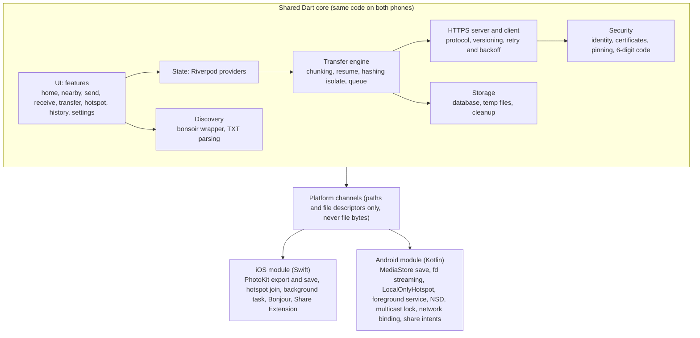
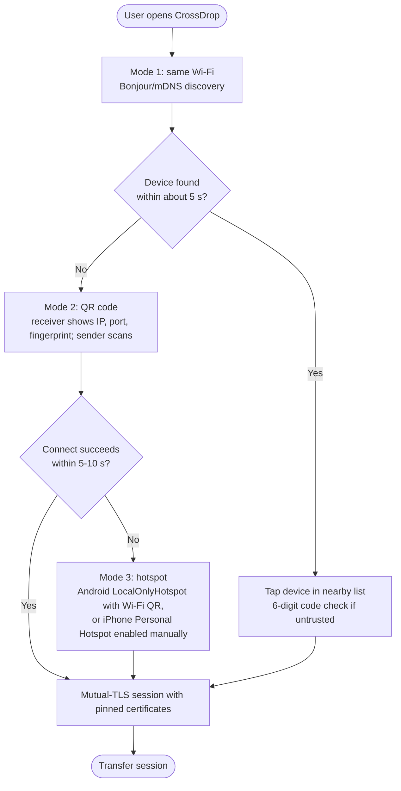
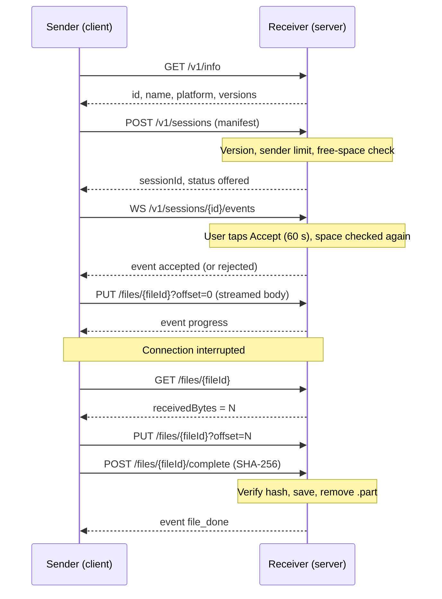
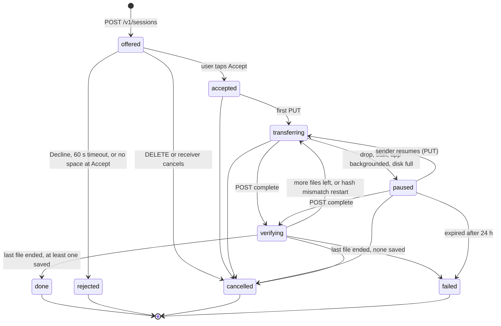

# CrossDrop Architecture: iPhone ↔ Android File Sharing

Nov 1, 2026 · @yash

CrossDrop v1 is a Flutter app in which each phone runs a small encrypted HTTPS server. The phones find each other over the local network (or connect through a hotspot) and send files straight to each other, with no cloud server. This document covers only iPhone ↔ Android, in both directions.

## Scope and assumptions

**In scope**

- iPhone → Android and Android → iPhone transfers of photos, videos and any other file.
- Both phones nearby with the CrossDrop app open in the foreground.
- Three connection modes: same Wi-Fi, an Android hotspot, or an iPhone Personal Hotspot.
- Original quality, end-to-end encryption, resume after interruption.

**Out of scope for v1**

- iPhone ↔ iPhone and Android ↔ Android. The protocol is symmetric, so these work later with little change, but they are not tested in v1.
- Phones on different networks or far apart (needs an internet relay).
- Receiving while the app is closed or in the background on iPhone (iOS does not allow it).
- Accounts, cloud storage, chat.

**Design principles**

1. **Receiver is the server.** The phone that receives runs an HTTPS server; the sender is the client. This works the same in every network mode.
2. **One shared core in Dart.** Protocol, transfer engine, security and UI are shared. Native Swift and Kotlin only where the OS requires it (photo library, hotspot, background, Bonjour).
3. **Never trust the network.** Every connection uses mutual TLS with pinned certificates, and the receiver always approves unknown senders.
4. **Every byte is resumable.** Files are written to a partial file and resumed from the last confirmed byte.
5. **Stream, never buffer.** No file is ever fully loaded into memory.
6. **Fail loudly and suggest the next mode.** If one connection mode fails, the app tells the user which mode to try next.

## System overview



> Diagram drafted from the prose and the Platform modules and Code structure sections. Please review.

Everything above the platform channels is shared Dart code that runs the same on both phones. The two native modules only handle what the OS requires: photo library, hotspot, background behavior, Bonjour/NSD and sharing from other apps.

## Connectivity scenarios

Three scenarios are supported in v1: shared Wi-Fi, an Android hotspot, and an iPhone hotspot. Everything else is detected and gets a clear message.

| # | Situation | v1 support | How CrossDrop handles it |
| --- | --- | --- | --- |
| 1 | Both on the same home or office Wi-Fi | Yes (primary) | Bonjour/mDNS discovery, direct HTTPS over the router |
| 2 | Same Wi-Fi, but mDNS is blocked or filtered (some mesh routers, office networks) | Yes | Discovery fails, so the receiver shows a QR code with its IP, port and certificate fingerprint; the sender scans it |
| 3 | Guest or public Wi-Fi with client isolation (cafe, hotel, airport) | No direct path | Detected when both discovery and QR connect time out; the app suggests offline hotspot mode |
| 4 | No Wi-Fi; Android creates a hotspot, iPhone joins | Yes (recommended offline mode) | Android starts a LocalOnlyHotspot and shows one QR with Wi-Fi name, password and connection info; iPhone joins in-app via NEHotspotConfiguration |
| 5 | No Wi-Fi; iPhone Personal Hotspot, Android joins | Yes (manual) | User turns on Personal Hotspot in iOS Settings (apps can't); Android joins; then discovery or QR as usual |
| 6 | Same Wi-Fi but one phone has a VPN on | Sometimes | Some VPNs route or block local traffic; if connect fails and a VPN is detected, ask the user to pause it |
| 7 | Android joined a Wi-Fi with no internet (hotspot) | Yes, with care | Android may send traffic over mobile data instead; the app binds its sockets to the Wi-Fi network |
| 8 | Router splits 2.4 GHz and 5 GHz, or mesh nodes | Usually yes | Same subnet works; separate VLANs act like scenario 3 |
| 9 | Phones on different networks or mobile data only | No (future) | Needs a relay (WebRTC + TURN); message: "Get on the same Wi-Fi or use hotspot mode" |
| 10 | No Wi-Fi and no hotspot possible, direct radio link | No (future) | Wi-Fi Aware on iOS 26+ newer iPhones and supporting Androids; research later |

**Which mode is fastest?** Usually the hotspot modes. On a router, data goes phone → router → phone, sharing airtime twice. In hotspot mode one phone is the access point, so the data crosses the air once. Measure this on your devices before stating it in the app.

## Connection flow



> Diagram drafted from the Connectivity scenarios and Failure handling sections. Please review.

The app tries the easiest mode first and moves to the next only when one fails. Every path ends in the same mutual-TLS session, so the transfer engine never cares how the phones are connected.

## Transfer session



> Diagram drafted from the Protocol spec and Transfer rules sections. Please review.

Solid arrows are sender requests; dashed arrows are receiver replies and events. After an interruption, the sender asks how much arrived and continues from that byte, so nothing is sent twice.

## Protocol spec (v1)

The protocol is plain HTTPS with JSON for control and streamed request bodies for file data, plus one WebSocket per session for live events. All endpoints are on the receiver.

**Discovery advertisement (Bonjour/mDNS)**

- Service type: `_crossdrop._tcp`, port = the receiver's random listening port.
- Instance name: `CrossDrop-<first 8 characters of the device UUID>`. It carries no personal data and rarely clashes; the device name is only in TXT `n`.
- TXT record: `v=1` (protocol version), `id=<device UUID>`, `n=<device name, at most 63 UTF-8 bytes>`, `p=ios|android`, `fp=<first 16 hex chars of certificate SHA-256>`. Keys are case-insensitive. A record with a newer `v` needs only `v`, `id` and `n` and is listed as "needs update".
- The TXT fingerprint is a hint only. The full fingerprint is checked in the TLS handshake.
- Browsers ignore records with a bad TXT, their own id, or no IPv4 address in a local range (10/8, 172.16/12, 192.168/16, 169.254/16, 100.64/10), so an advertisement can never point the app outside the local network.
- In Phase 2 a phone advertises only while its Receive screen is open (D-016). It re-advertises when the Wi-Fi or IP changes and when the app returns to the foreground.

**QR code payload**

`crossdrop://connect?v=1&ip=192.168.1.23&port=53317&fp=<full SHA-256 fingerprint>&id=<device UUID>&n=<name>`

In offline hotspot mode the Android QR also carries the Wi-Fi name and password, so one scan joins the network and connects.

Parsing is strict. Every listed parameter must appear exactly once, and unknown parameters are ignored, so later versions can add fields. Each field is checked:

- `ip`: a dotted IPv4 literal in one of the local ranges above. Hostnames are never resolved.
- `port`: 1–65535.
- `fp`: 64 hex characters.
- `id`: a UUID.
- `n`: sanitized.

Payloads over 1024 characters, or with control characters or stray `%` escapes, are refused. QR payloads are never logged. A typed IP and port follows the same address rules.

**Endpoints**

| Method | Path | Purpose |
| --- | --- | --- |
| GET | `/v1/info` | `{"id", "name", "platform", "versions": [1]}`. The sender calls it before every connect to check the protocol version and, from the list or a QR code, the device id |
| POST | `/v1/sessions` | Sender offers a session with a file manifest; returns `sessionId`, status `offered` (D-018). Refusals: 400 `unsupported_version` (with `versions`), 409 `sender_busy`, 503 `busy` (8 sessions open), 507 `no_space` (with `neededBytes`) |
| GET | `/v1/sessions/{id}` | `{"sessionId", "status", "reason"?, "files": [file status]}`, so a sender that reconnects knows where the session stands |
| WS | `/v1/sessions/{id}/events` | Live events: `accepted`, `rejected`, `progress`, `file_done`, `cancelled`, `error`. A new socket first gets the current state replayed |
| PUT | `/v1/sessions/{id}/files/{fileId}?offset=N` | Streams file bytes starting at byte N. 403 `not_accepted` before Accept, 409 `offset_mismatch` (with `receivedBytes`), 410 `session_closed` or `file_failed`, 413 `too_many_bytes`, 507 on a write failure |
| GET | `/v1/sessions/{id}/files/{fileId}` | `{"fileId", "size", "receivedBytes", "status"}`, status `pending`, `receiving`, `verifying`, `saved` or `failed`, so the sender knows where to resume |
| POST | `/v1/sessions/{id}/files/{fileId}/complete` | Sender sends the SHA-256; receiver verifies and saves. 422 `hash_mismatch` with `retry: true` (file restarted from zero) or `file_failed` with `retry: false` |
| DELETE | `/v1/sessions/{id}` | Cancel from the sender's side; idempotent. The receiver's own cancel reaches the sender as the `cancelled` event or a 410 |

Errors are JSON: `{"error": code, "message": text, ...details}`.

**Events (WebSocket, receiver to sender)**

One JSON text frame per event, with a `type` field. Unknown types are ignored, so later versions can add some.

| Type | Fields | When |
| --- | --- | --- |
| `accepted` | none | The user tapped Accept |
| `rejected` | `reason` (`declined`, `timeout`, `no_space`), `neededBytes`? | The offer was refused |
| `progress` | `fileId`, `receivedBytes` | At each 4 MB checkpoint, so these bytes are on disk |
| `file_done` | `fileId` | The file was verified and saved |
| `cancelled` | `by` (`sender` or `receiver`) | Either side cancelled |
| `error` | `code`, `fileId`? | A file failed (`too_many_bytes`, `hash_mismatch`, `file_failed`), or the disk filled up (`no_space`) |

The events are a convenience. Every fact they carry is also in the HTTP replies, so a lost socket never stops a transfer.

**Limits on an offer:** at most 10,000 files, names at most 1,024 characters before sanitizing, one unfinished session per sender, 8 open sessions in total (D-023).

**Offer manifest (POST /v1/sessions)**

```json
{
  "protocol": 1,
  "sender": {"id": "uuid", "name": "Shreyash's iPhone", "platform": "ios"},
  "files": [
    {"fileId": "f1", "name": "IMG_4021.MOV", "size": 1288490188, "mime": "video/quicktime",
     "kind": "video", "created": "2026-10-30T18:22:00Z", "livePhotoGroup": null}
  ]
}
```

The SHA-256 is not in the offer, so the sender can start sending before hashing finishes. It hashes in a background isolate alongside the upload and sends the hash in `complete`. `kind` is `photo`, `video` or `file`; an unknown kind from a newer peer reads as `file`. `created` and `livePhotoGroup` are optional.

**Transfer rules**

1. The receiver checks free space before accepting. The free space must cover the offer, the bytes other open sessions still expect, and a 64 MB reserve, on both the temp and the save volume. It checks again when the user taps Accept.
2. Data is written to `<app support>/crossdrop_incoming/<sessionId>/<fileId>.part` (D-025). Every 4 MB, and whenever an upload stops, the part file is fsynced and then the received byte count is saved. After a crash the part file is cut back to that count (D-022).
3. On reconnect, the sender calls GET on the file, then PUT with `offset = receivedBytes`. Retries wait 1, 2, 4, 8 s, then 8 s, and stop after about 2 minutes without progress (D-019).
4. Files go one at a time on one connection in v1. Parallel streams (2–4) are added only if benchmarks show a gain.
5. Read and write buffers start at 1 MB; tune after benchmarks.
6. On `complete`, the receiver compares SHA-256 (computed incrementally while writing, kept across drops; hashed from disk after an app restart, D-021). On mismatch, the file restarts from zero once, then fails.
7. After verification the file is moved into the gallery or Files (see Platform modules) and the `.part` is removed.
8. More bytes than declared, by Content-Length or by count, fails that file and deletes its partial file. The other files continue.
9. A session ends `done` when every file is saved or failed and at least one was saved, and `failed` when none was.

**Versioning:** `GET /v1/info` lists the versions the receiver supports, and the sender picks the highest common one. If there is none, the app says "Update CrossDrop on the other phone". The offer carries the chosen version in `protocol`; the receiver refuses others with 400 `unsupported_version` and its own list.

## Session state machine

The receiver's state for one session (`SessionStatus`, `lib/core/engine/session_state_machine.dart`). The wire `status` is the state name.



- After an app restart, a stored session in any non-final state comes back as `paused`, except `offered`, which becomes `rejected` (`timeout`).
- Every state can move to `failed` for an unrecoverable error. The diagram shows the common causes only.
- Each file has its own status: `pending → receiving → verifying → saved`, or `failed`.

The sender has its own view (`SendPhase`): `connecting → waitingForAccept → sending ⇄ retrying / paused → done`, or `rejected`, `cancelled`, `failed`. A `failed` caused by the network or a full disk on the receiver stays resumable.

## Security model

Each phone has its own key and certificate, both sides prove their identity with mutual TLS, and a stranger can never push a file without the receiver tapping Accept.

**Device identity**

- On first launch the app creates a random device UUID and an ECDSA P-256 key pair with a self-signed certificate. The private key lives in the iOS Keychain or the Android Keystore-protected storage.
- The certificate's SHA-256 fingerprint is the device's identity. The device name is only a label and can be faked.

**Connection security**

- The receiver's server requires a client certificate (mutual TLS). The receiver learns the sender's fingerprint, and the sender checks the receiver's fingerprint against the one from the QR code or a trusted-device record.
- Dart's TLS stack lets the app pin these self-signed certificates itself, so iOS App Transport Security does not get in the way.

**Pairing: two ways to trust a device**

1. **QR scan (strong).** The QR carries the full fingerprint, so the TLS check proves you reached the phone in front of you.
2. **Tap from the nearby list (needs a check).** The mDNS fingerprint could be spoofed, so both phones show the same 6-digit code derived from both fingerprints, like Bluetooth pairing. The receiver confirms that it matches.

After either method the user can choose "Trust this device". Next time, the app skips the code check but still shows the Accept prompt unless the user turns on auto-accept for that device.

**Threats and defenses**

| Threat | Defense |
| --- | --- |
| Stranger on the same Wi-Fi sends unwanted files | Accept prompt on every session from an untrusted device; rate limit offers per IP; "Receiving" can be turned off |
| Someone fakes a device name in the nearby list | Identity is the fingerprint; 6-digit code check for untrusted devices |
| Eavesdropping on the Wi-Fi | TLS 1.3 encryption on all traffic |
| Man-in-the-middle | Fingerprint pinning from QR or trusted record; mutual TLS |
| Malicious file name such as `../../evil` | Sanitize names: strip paths, control characters and reserved names; limit length |
| Huge offer to fill the disk | Free-space check before accepting; reject if the file is larger than declared |
| Corrupted or tampered file | SHA-256 verified before saving |
| Server left open in public | Server runs only while the app is open; rotate the listening port each launch |
| Old protocol version with a known bug | Minimum supported version in the app; reject below it |

**Privacy:** no accounts, no analytics on file names or contents, nothing leaves the local network.

## Platform modules

Most platform risk sits in four areas: how files are read, how they are saved, what happens when the screen locks, and how photo formats translate between the two systems. Each row below is a native module behind a Flutter platform channel or an existing plugin. Check exact API and permission names against current Apple and Android docs when you build.

| Area | iPhone (Swift) | Android (Kotlin) |
| --- | --- | --- |
| Discovery | Bonjour through the `bonsoir` plugin (NWBrowser and DNSServiceRegister). Avoid raw multicast sockets: they need a special Apple entitlement. Requires `NSBonjourServices` and `NSLocalNetworkUsageDescription`. | NsdManager (same plugin). A Wi-Fi multicast lock is held while browsing or advertising: bonsoir takes it on start and releases it on stop, and the app stops browsing in the background. Permissions: `CHANGE_WIFI_MULTICAST_STATE`, `ACCESS_WIFI_STATE`, `ACCESS_NETWORK_STATE`; no location. |
| Local network permission | System prompt on first discovery. If denied, nothing is found and connections fail. Detection (D-015): after 5 s with no peers, a Swift probe advertises and browses a short-lived Bonjour service; still `PolicyDenied` at 8 s means denied. The app then explains why and links to Settings. | No prompt on same Wi-Fi. `NEARBY_WIFI_DEVICES` on Android 13+ for hotspot features. |
| QR scanning | `mobile_scanner` (AVFoundation); needs `NSCameraUsageDescription`. | `mobile_scanner` (ML Kit); `CAMERA` asked at runtime. |
| Picking photos and videos | PhotoKit via `photo_manager`, which gets the original file. The default image picker may convert or compress. Handle "Limited" photo access. | MediaStore via `photo_manager`; `READ_MEDIA_IMAGES` and `READ_MEDIA_VIDEO`, or the system Photo Picker. |
| iCloud-only originals | If "Optimize iPhone Storage" is on, the original may be in iCloud. Download it first (needs internet) and show "Preparing". | Not applicable. |
| Picking other files | Document picker; files arrive as security-scoped URLs. | Storage Access Framework; content URIs read through ContentResolver. |
| Reading for sending | Export the asset to a temp file, then stream from it. A large video briefly needs equal free space. | Open the content URI as a file descriptor and stream it without copying. |
| Saving received media | `PHAssetCreationRequest` with the received file, moved rather than copied. Needs add-to-photos permission. | Insert into MediaStore as a pending item, write directly into it, then publish. No extra copy. |
| Saving other files | App Documents folder, visible in the Files app (`UIFileSharingEnabled`, `LSSupportsOpeningDocumentsInPlace`). | MediaStore Downloads collection in `Download/CrossDrop`. |
| HEIC photos (iPhone → Android) | Default: send the original HEIC. Optional setting: convert to JPEG before sending (costs time, slight quality loss). | Most modern Android galleries open HEIC; older ones may not. Show a hint if a gallery can't open it. |
| Live Photos (iPhone → Android) | Two resources: still photo and short MOV. Default: send the still; optional: send both. | Saved as a photo, plus a video if both were sent. No Live Photo playback. |
| HEVC / HDR video (iPhone → Android) | Send the original. | Most phones play HEVC. Dolby Vision HDR may look washed out on some Androids; note it in help, don't transcode in v1. |
| Android → iPhone formats | JPEG, PNG, MP4 open fine. WebP opens on recent iOS. Uncommon formats are saved to Files instead of Photos. | Not applicable. |
| Screen lock during transfer | Keep the screen on during a transfer (`wakelock_plus`). Use a short background task to finish the current chunk and save progress; resume when the app returns. | Foreground service of type data sync with a progress notification; transfer continues with the screen off. Needs `POST_NOTIFICATIONS`. |
| Battery and OEM killers | Not applicable. | Some brands (Xiaomi, Oppo, Vivo, OnePlus) kill background apps aggressively. Ask the user to exempt CrossDrop from battery optimization if transfers stop. |
| Hotspot | Can't create one from an app; the user turns on Personal Hotspot. Can join an Android hotspot in-app via NEHotspotConfiguration (needs the Hotspot Configuration capability). | LocalOnlyHotspot creates one with a random name and password; no internet sharing. |
| Network binding | Local subnet traffic goes over Wi-Fi even without internet. | When the Wi-Fi has no internet, bind the process or socket to that Wi-Fi network, or traffic may go over mobile data. |
| Share from other apps | Share Extension target; it hands the files to the main app, which does the transfer (extensions have tight memory limits). | Intent filters for `SEND` and `SEND_MULTIPLE`. |

## Failure handling

Every failure ends in one of three outcomes: an automatic resume, a clear message with the next step, or a clean cancel that leaves no half-saved files.

| Failure | How it's detected | Recovery |
| --- | --- | --- |
| No devices found | Discovery shows nothing after about 5 s | Check Local Network permission (iOS) and Wi-Fi; offer QR scan; then offer hotspot mode |
| Local Network permission denied (iOS) | Nothing found within 5 s, then the Bonjour self-probe (D-015) stays in `PolicyDenied` | Explain why it's needed; button to open Settings; probe again on return |
| Receiver's Wi-Fi or IP changes | Connectivity event or a changed address list (3 s poll) | Re-advertise and redraw the QR code; the sender's nearby list restarts browsing |
| Stale entry in the nearby list | `GET /v1/info` fails, or another device id answers | Remove the entry and tell the user; pull to refresh |
| QR connect times out | TCP connect fails within 5–10 s | Likely client isolation or different networks; suggest hotspot mode |
| Certificate fingerprint mismatch | TLS handshake fails pinning check | Stop; warn "This isn't the device you scanned"; never fall back to unpinned |
| Receiver rejects or doesn't answer | `rejected` event, or no answer within 60 s | Tell the sender; nothing is sent |
| Not enough space on receiver | Free-space check before the prompt and again at Accept, and write errors during transfer | Reject the offer with the needed size; if it runs out mid-transfer, pause and keep the partial file; the sender stops with "free some space, then Resume" |
| Wi-Fi drops mid-transfer | Socket error or no progress for 15 s | Retry with backoff (1, 2, 4, 8 s, then 8 s, up to about 2 min without progress, D-019); resume from `receivedBytes`. After that, the Send screen offers Resume |
| iPhone screen locks or app backgrounded | App lifecycle events (hidden) | Inside a background task: the sender finishes the current chunk and pauses, the receiver saves progress. On return the sender continues; time in the background does not use up the retry deadline |
| Android app killed by battery saver | Session lost; partial file remains | On next launch, show "Resume unfinished transfer?"; resume if the sender reconnects |
| App crash or phone restart | Partial files and session rows in the database | Part files cut back to the last checkpoint; same resume prompt; delete partial files older than 24 hours |
| Receiver app restarts | The server listens on a new random port | The sender finds it again by device id over mDNS after 3 failed tries, once Receive is open |
| Hash mismatch | `complete` verification fails | Restart that file from zero once; then mark it failed; the other files continue |
| More bytes than declared | Content-Length or counting on the receiver | That file fails and its partial file is deleted; the other files continue |
| Peer IP changes (DHCP, reconnect) | Connection refused at the old address | Rediscover by device id via mDNS and continue |
| Source file gone or changed | Size check before offering and before each file | Cancel the session (v1 cannot skip a file) and say which problem it was |
| VPN blocks local traffic | Connect fails while a VPN is active | Suggest pausing the VPN |
| iCloud original won't download | Export fails or times out on iPhone | Skip the file or send the local version, if one exists, with a note |
| Unsupported format on the receiver | Gallery insert fails | Save to Files or Downloads instead and tell the user |
| Protocol version mismatch | `/v1/info` versions don't overlap | "Update CrossDrop on the other phone" |
| User cancels | Cancel tap on either side | DELETE the session; receiver deletes partial files; both show "Cancelled" |

## Data model, code structure and performance

**Local database (drift or sqflite)**

| Table | Key fields |
| --- | --- |
| `identity` | deviceId, deviceName, certificate (private key stays in Keychain/Keystore) |
| `trusted_devices` | deviceId, name, platform, certFingerprint, autoAccept, firstSeen, lastSeen |
| `sessions` | sessionId + direction (unique), peerDeviceId, peerName, peerPlatform, peerHost and peerPort (send), status, reason, totalBytes, createdAt, updatedAt, finishedAt |
| `session_files` | session row + fileId, position, name, size, mime, kind, created, livePhotoGroup, sha256, transferredBytes, tempPath, sourcePath (send), finalLocation, status, hashAttempts, errorCode |
| `settings` | receivingEnabled, convertHeicToJpeg, sendLivePhotoVideo, saveLocation (not built yet) |

Session status: see [Session state machine](#session-state-machine). Both directions are stored. A sent session that gave up on the network stays `paused`, so the launch prompt can offer to resume it.

**Code structure**

```text
crossdrop/
  lib/
    app/            # routing, theme, Riverpod providers
    features/
      home/         # "Ready to receive" + send button
      nearby/       # discovered devices list, QR scanner
      send/         # file picking, offer screen
      receive/      # incoming request, accept/reject
      transfer/     # progress, speed, cancel, done
      hotspot/      # offline mode flow
      history/      # past transfers
      settings/
    core/
      protocol/     # message models, versioning, JSON
      server/       # HTTPS server, routes, session handlers
      client/       # HTTPS client, upload streams, retry/backoff
      engine/       # chunking, resume, hashing (isolate), queue
      discovery/    # bonsoir wrapper, TXT parsing
      security/     # identity, certs, pinning, 6-digit code
      storage/      # database, temp files, cleanup
    platform/       # Dart side of platform channels
  ios/
    Runner/         # PhotoKit export/save, hotspot join, background task
    ShareExtension/
  android/
    app/src/main/kotlin/  # MediaStore save, fd streaming, LocalOnlyHotspot,
                          # foreground service, multicast lock, network binding
  test/             # protocol, engine, resume unit tests
  integration_test/ # two-device transfer tests
```

**Performance design**

- One TLS connection per session, reused for every file.
- Stream reads and writes with 1 MB buffers to start; benchmark 256 KB, 1 MB and 4 MB.
- Hash with SHA-256 incrementally in a background isolate, so the UI never stutters.
- Don't pass file bytes through platform channels: Dart reads files directly (temp file on iPhone, file descriptor on Android).
- Save progress every 4 MB, not every write, to keep database writes low.
- Calculate speed as a moving average over the last 3 seconds.
- Benchmark matrix: 10 MB, 100 MB, 1 GB, 2 GB files × router 2.4 GHz, router 5 GHz, Android hotspot, iPhone hotspot × both directions. Compare with LocalSend on the same phones.

## Open decisions

- [ ] Custom protocol (this document) or LocalSend-compatible protocol? Compatibility would let CrossDrop talk to LocalSend users; check its protocol and license first.
- [ ] HEIC default: send original (recommended) or convert to JPEG for Android?
- [ ] Live Photos default: still only (recommended) or still plus video?
- [ ] Is iPhone Personal Hotspot mode worth an in-app guide in v1, or Android hotspot mode only?
- [ ] Trusted devices: allow auto-accept, or always show the Accept prompt?
- [ ] Minimum OS versions (for example iOS 16+ and Android 10+), which decides which APIs you can use without fallbacks. Current project defaults: iOS 15, Android 7.0 (SDK 24); all Phase 2 packages support these.
- [ ] What speed target counts as success, decided after the Phase 1 proof of concept measures real numbers?
