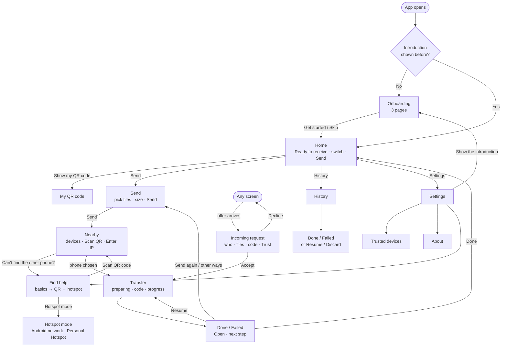

# Feature: UI and navigation

- Phase: 6
- Status: Built, awaiting device tests
- Last updated: 2026-11-03

## Summary

The screens of CrossDrop v1 and how the user moves between them. Home is also the receive screen: while CrossDrop is open and Receiving is on, the phone can be found and offers appear on top of any screen. Sending goes files first, then the phone. The same Progress, Done and Failed screens serve both directions, and every failure says what happened and what to do next.

## Scope

**In scope**

- Home, My QR code, Send, Nearby, "Can't find the other phone?", Incoming request, Progress, Done and Failed, Hotspot mode (UI), History, Settings, Trusted devices, About.
- Light and dark theme following the system; large system text; screen-reader labels.
- Open a received file from Done and History.

**Out of scope** (and which phase picks it up)

- Starting a hotspot from the app, joining it from the QR code, Android network binding: Phase 7. The Hotspot screens are built against `HotspotService`; its stub says "not yet" and explains the manual way.
- Localization: v1 is English only.
- Tablets and landscape layouts: the screens work, but are not designed for them.

## Design

### Screen flow

### Decisions

- **Home is the receive screen (D-046).** `ReceiveHost`, above the navigator, keeps the receive controller alive from the end of onboarding on. The server stops 30 s after the app is hidden with nothing in flight, and starts again on a new port when the app is shown. It no longer keeps the screen on by itself; transfers and the My QR code screen do.
- **Navigation is `Navigator` with named routes (D-047)** (`lib/app/navigation.dart`). `topRouteObserver` lets the share listener and the offer prompt avoid duplicates.
- **One view model for both directions (D-048).** `TransferView` is built from the sender's `SendSnapshot`, the receiver's `IncomingSession` or a stored session. `ProgressView` and `ResultView` are plain widgets that take it, so they are tested without the engine.
- **One failure table (D-049).** `failure_messages.dart` maps every reason code to a title, a plain reason, a next step and a button (`NextAction`), following [ARCHITECTURE.md, "Failure handling"](../ARCHITECTURE.md#failure-handling).
- **Open is our own channel (D-051).**
- **Files first, then the phone (D-052).** Sizes of photos and videos are known only after they are prepared, so Send shows "at least" until then.
- **The sender can pause (D-053).**

### Screens

| Screen | What it shows | Notes |
| --- | --- | --- |
| Home | "Ready to receive" (or Starting, Not on Wi-Fi, Receiving is off, Cannot receive) with this phone's name, the Receiving switch, Show my QR code, transfers in progress, a large Send button | The status is a live region, so screen readers announce changes |
| My QR code | The QR code (white background in dark mode), the device name, the IP and port under "No camera?" | Keeps the screen on while open |
| Send | Photos & videos, Files, the selected items with remove, count and size, Send | Shares from other apps open here with the files selected |
| Nearby | Each phone's name, platform and connection hint ("same Wi-Fi", "via iPhone hotspot"); Scan QR code, Enter IP, "Can't find the other phone?" | Pops with the checked target. Errors come from the failure table |
| Find help | 1. Check both phones (iPhone: Local Network, with a Settings link) 2. QR code 3. Hotspot mode | Order of the connection flow |
| Incoming request | Name, platform, Trusted or Not trusted; first-time or lookalike warning; count, size, first five names; 6-digit code and "Trust this device" (untrusted); 60 s countdown; Decline and Accept | Full screen on top of any screen; Back declines |
| Transfer: Progress | Who, stage in words, total bar with %, bytes, speed, time left, the code while waiting for Accept, per-file rows, Pause or Resume (sender) and Cancel | iPhone: "Keep CrossDrop open and the screen on". Android: the notification keeps it going |
| Transfer: Done | Count, size, where files were saved (with the reason for a fallback), Open per file; sender: "checked with SHA-256" and Trust | |
| Transfer: Failed | Title, "What happened", "What to do", one button (Resume, Send again, Other ways to connect), files not saved with why | Also for partly successful transfers |
| Hotspot mode | Choices depend on the phone: Android makes a network or joins Personal Hotspot; iPhone joins the Android or turns on Personal Hotspot | UI only (Phase 7) |
| History | Last 200 transfers by day: direction, device, platform, count, size, status, time | Detail: Done/Failed view, or View, Resume, Discard for unfinished ones |

### Accessibility

- Text sizes come from the theme, so the system text size scales everything. No fixed heights; rows and buttons wrap.
- Buttons are at least 48 dp tall. Icon buttons have tooltips, which screen readers read.
- File rows, history rows and numbered steps are one screen-reader node each. The pairing code is read digit by digit. Progress bars carry their percentage.
- Colors come from the Material 3 scheme seeded with teal. A test checks WCAG AA (4.5:1) for the main text pairs in light and dark; warnings use the error or secondary container colors.
- Flutter's tap-target, label and contrast guidelines run on every Phase 6 screen in both themes, and Home, Send, Settings and History also on a 320 × 568 phone with 2× text.

## Code

| Path | Purpose |
| --- | --- |
| `lib/app/theme.dart`, `lib/app/navigation.dart` | Theme, route names, navigator keys |
| `lib/features/receive/receive_host.dart` | Keeps receiving running; shows offers; `receiveStateProvider` |
| `lib/features/home/` | Home, status card, in-progress tiles |
| `lib/features/receive/my_qr_screen.dart`, `incoming_request_screen.dart` | My QR code, Incoming request |
| `lib/features/send/send_screen.dart` | Send |
| `lib/features/nearby/nearby_screen.dart`, `find_help_screen.dart` | Nearby, help |
| `lib/features/transfer/transfer_view.dart` | `TransferView` for both directions |
| `lib/features/transfer/failure_messages.dart` | Failure table |
| `lib/features/transfer/transfer_screen.dart`, `progress_view.dart`, `result_view.dart` | Transfer screen, Progress, Done and Failed |
| `lib/features/hotspot/` | Hotspot mode screens |
| `lib/features/history/history_screen.dart` | History and detail |
| `lib/platform/open_file.dart`, `ios/Runner/OpenFileChannel.swift`, `MainActivity.kt` | Open a received file |
| `lib/platform/hotspot.dart` | `HotspotService` interface and the Phase 6 stub |

## Protocol and API

No protocol or security change. New platform channel `crossdrop/open`: `open {location}` → `bool`. Android takes only `content://media/...` URIs; iOS takes `photos:<id>` (opens Photos) or a path inside Documents (Quick Look). Anything else returns false.

`SendController` gains `pause()`, `continueSending()` and `removePicked()`. `ReceiveController` stops when hidden and idle, and waits for the launch cleanup before it restores sessions.

## Tests

**Unit and widget tests (no phones)**

- `test/features/transfer/`: `TransferView` mapping, failure table, Progress, Done and Failed.
- `test/features/receive/incoming_request_screen_test.dart`: untrusted, trusted, lookalike, trust only on accept, Back, countdown, large text.
- `test/features/nearby/find_help_test.dart`, `test/features/hotspot/`, `test/features/history/`, `test/features/send/`.
- `test/a11y/`: guidelines in both themes, small phone with 2× text.
- `test/app/theme_test.dart`: contrast.

**Device checks**

Listed in [DEVICE_TESTS.md](../DEVICE_TESTS.md), section "Phase 6".

## Known limits and risks

- Receiving now runs whenever CrossDrop is open (D-046). Other phones on the same Wi-Fi see this phone's name while the app is open; untrusted senders still need Accept and the code.
- iOS shows the Local Network prompt right after onboarding, not when the user first taps Send. Someone who taps Don't Allow cannot receive until they change it in Settings. Find help explains how.
- "Open Photos" on iPhone opens the Photos app, not the photo: there is no public API to show one asset. It uses the `photos-redirect://` URL scheme, which is undocumented.
- The size of photos and videos is shown only once sending starts.
- The connection hint recognises the iPhone hotspot by its 172.20.10.x addresses only. Everything else found by discovery is labelled "same Wi-Fi".

## Open questions

None.
